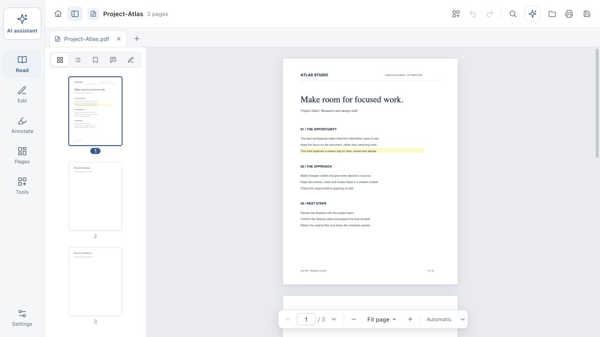

[**EN**](README.md) | [中文](README.zh-CN.md)

<div align="center">
  
  <h1>Sail PDF</h1>
  <p>A focused PDF workspace for your Mac.</p>
  <p>Read, annotate, edit and organize documents — with an optional AI assistant beside the page.</p>
  <p><a href="https://sailpdf.pages.dev/">Website</a> · <a href="https://github.com/csuhan/SailPDF/releases">Download beta</a> · <a href="https://github.com/csuhan/SailPDF/issues">Feedback</a></p>
  <p><a href="LICENSE"></a>  <a href="https://github.com/csuhan/SailPDF/actions/workflows/ci.yml"></a></p>
</div>



## A workspace built around the document

|                            | What you can do                                                                                                                                                         |
| -------------------------- | ----------------------------------------------------------------------------------------------------------------------------------------------------------------------- |
| **Read comfortably**       | Keep multiple PDFs open in separate tabs, search text, browse outlines and bookmarks, and choose original, warm, green or dark reading colors.                          |
| **Annotate and review**    | Add notes, highlights, underlines, strikeouts, drawings and shapes. Manage standard PDF annotations, including deleting existing marks.                                 |
| **Make focused edits**     | Edit supported text and images, add content, fill forms, place visual signatures, and undo changes.                                                                     |
| **Organize and export**    | Reorder, rotate, merge, split and extract pages; export text, images and supported document formats; compress, protect or redact a PDF.                                 |
| **Work with an assistant** | Ask questions with source references, summarize passages and review proposed changes before applying them. Choose an on-device model or your own compatible AI service. |
| **Keep control**           | Recovery drafts include form values. Output validation and external modification checks help prevent accidental overwrites.                                             |

The interface and native menus support **English and Simplified Chinese**. English is the default; change it in **Settings → Appearance & reading → Interface language**. Your documents, notes and conversations keep their original content. AI answer language is configured separately.

## Download

The current packaged beta supports **macOS on Apple Silicon**. Get the DMG or ZIP and its checksums from [GitHub Releases](https://github.com/csuhan/SailPDF/releases).

**This beta is unsigned and not notarized.** macOS may show a security warning. Keep backups of important documents and review saved results, especially for complex layouts and fonts. Windows, Linux and Intel Mac installers are not included in this release.

## Privacy and AI

Reading, annotations and standard document operations run locally and do not require an application account. AI is optional:

- **On-device models:** the app bundles llama.cpp; model weights are downloaded only when you choose a model. Inference runs on your Mac.
- **Custom services:** document context required for your task is sent to the endpoint you configure. Review the provider's data practices before using private documents.
- **Credentials:** desktop API keys use system-protected encryption. Browser keys stay in memory for the session. Feedback and diagnostics are never submitted automatically.

See the [privacy notice](public/legal/PRIVACY.en.txt), [beta limitations](public/legal/TERMS.en.txt) and [model notices](public/legal/MODEL_NOTICES.en.txt). Local processing is not a guarantee that an external service keeps data on your network.

## Run from source

Use **Node.js 24** (see [.nvmrc](.nvmrc)) and npm. The repository contains source files; generated assets, test PDFs, native binaries and model weights are not committed.

```sh
git clone https://github.com/csuhan/SailPDF.git
cd SailPDF
npm ci
npm run dev
```

Open the printed localhost URL for the browser build. To launch the desktop app on a Mac:

```sh
npm run app
```

To package the complete Apple Silicon app, including the OCR helper and pinned inference runtime, install Xcode Command Line Tools and run:

```sh
npm run app:dmg
```

The build downloads and verifies the official llama.cpp runtime, compiles the Swift OCR helper, generates icons, builds the frontend and creates the DMG under `release/`. No model weights are bundled. See the [development guide](docs/guides/DEVELOPMENT.md) and [release guide](docs/guides/RELEASING.md).

## Tests

```sh
npm test                 # Code, file protection, security and localization checks
npm run build            # Type checking and production build
brew install qpdf        # Test-fixture prerequisite on macOS
npm run test:fixtures    # Generate synthetic PDFs locally
npm run test:e2e         # Complete browser and code regression suite; requires Chrome
npm run test:native      # Real Electron security and language integration
```

Browser/font tests target macOS with Chrome and its standard system fonts. Fixtures are generated from synthetic content; PDFs containing system fonts stay local and are excluded from production builds. Tests do not require a real AI service or download model weights. Optional live-model scripts have separate prerequisites.

## Project layout

```text
src/          React UI, document state, PDF operations and AI client
electron/     Sandboxed desktop bridge, file protection and local model runtime
locales/      Interface translations
native/       macOS Vision OCR source
build/        Editable app icon source
scripts/      Asset generation, tests and packaging support
public/legal/ Privacy, usage and model notices
docs/         Project website served by Cloudflare Pages, images and contributor guides
```

## Limits worth knowing

Complex paragraph reflow, some font encodings and flattened annotations have editing limitations. A visual signature is not a certificate-based digital signature. AI answers can be wrong; verify references and proposed edits. Recovery drafts reduce risk but do not replace saving and independent backups.

## Contribute

Bug reports, small fixes and improvements are welcome. Read [CONTRIBUTING.md](CONTRIBUTING.md), use a synthetic or redacted reproduction, and keep private PDFs and credentials out of public issues. Report security vulnerabilities through the process in [SECURITY.md](SECURITY.md).

## License

Original project code is licensed under **[Apache License 2.0](LICENSE)**. See [NOTICE](NOTICE) for attribution. Third-party software, fonts and model weights retain their own licenses; applicable notices are generated from the installed dependencies and included in the application.
